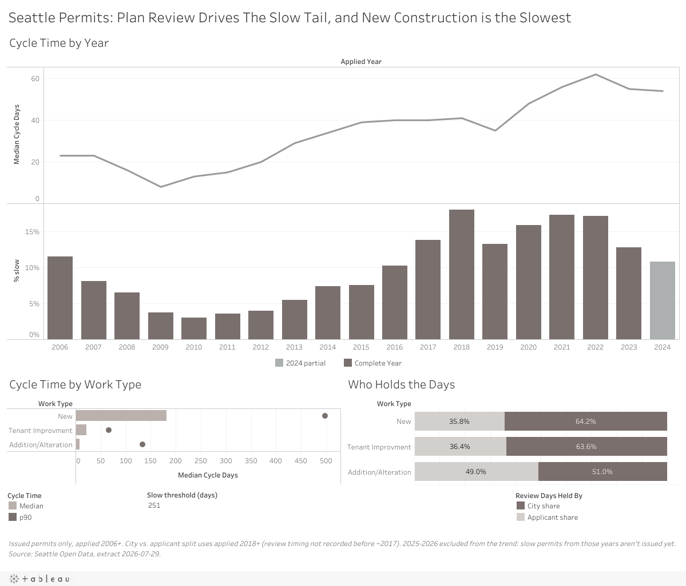

# Seattle Building Permit Cycle-Time Analysis

How long does Seattle take to issue a building permit, and where do the slow ones get stuck? I analyzed 133,560 permits in SQL and built an [interactive Tableau dashboard](https://public.tableau.com/app/profile/peter.jeong7168/viz/SeattleBuildingPermitProject/SeattlePermits).

## Main finding

Seattle's slow permits are a plan-review problem, and most of them are new construction. Half of all permits are issued within 32 days, but the slowest 10% take more than 251. For permits applied for in 2018 or later, the ones without plan review were issued in a median of 1 day. The ones with plan review took 111 days, and they make up 91% of the slow tail.

My recommendation is to cut the number of correction rounds on new construction (complete submittals up front, and first reviews that list every issue at once) and to track review rounds per permit as a leading KPI.

## The question

Some permits clear in days and others sit for months. Slow permits cost applicants money, and they cost the city fees, housing and goodwill. My [NYC vendor project](https://github.com/jeongwspeter/nyc-vendor-rationalization) asked where the money goes; this one asks where a process breaks down.

## Approach

I measured cycle time as the number of days from application to issuance. Process times are right-skewed, so I used the median and the 90th percentile (p90) instead of averages. Then I looked at trends over time and at which permits make up the slow tail.

Scoping decisions:

- **Applied in 2006 or later.** 2006 is the first full year in the current system. Earlier dates look like they were stamped during a data migration. Permits applied for in 2025-2026 are incomplete (only the ones already issued show up), so those years look faster than they really are. I flag them and leave them out of trend claims.
- **Never-issued permits** have no cycle time, so I looked at them separately as backlog. Permits that were issued and then canceled or withdrawn (788) stay in, because issuance did happen.
- **Building permits are compared by type of work** (New, Addition/Alteration, Tenant Improvement). The general permit-type field is too coarse to be useful: 91% of permits are "Building".

## Data

- **Source:** [Building Permits, City of Seattle Open Data portal](https://data.seattle.gov/Built-Environment/Building-Permits/76t5-zqzr) (dataset 76t5-zqzr).
- **Key columns:** application, issue, expiry and completion dates; status; permit type and class; estimated project cost; and stage durations: days waiting on the applicant (`DaysOutCorrections`), days with the city (`DaysPlanReviewCity`), total plan-review days, and number of review cycles.
- **Size:** snapshot from 2026-07-29, 191,830 records x 40 columns (97 MB). `PermitNum` is unique.
- **Tools:** MySQL with DBeaver for the analysis, Tableau for the dashboard.

## Queries (run in order)

| File | What it does |
|---|---|
| `00_load.sql` | Creates the database and `permits_raw`, loads the CSV (191,830 rows) |
| `01_profile.sql` | Row counts, date coverage, nulls, status values, records with missing dates, coverage by permit type |
| `02_clean.sql` | Builds `permits_clean`: typed dates, `cycle_days`, post-issue stage, review-timing columns (133,560 rows) |
| `03_analysis.sql` | Cycle-time distributions, trends, slow-tail breakdowns, headline numbers |

The output of each query is saved in `Exports/`.

## Findings

"Slow" means a cycle time above the citywide p90 of 251 days.

1. **The distribution is skewed.** Median 32 days, p90 251, mean 94. The mean is about three times the median, so I report the median and p90.
2. **Type of work matters more than permit type.** Among building permits, new construction has a median of 182 days and 33% are slow. Additions and alterations have a median of 8 days and 3.8% are slow. New construction is 18% of building permits but 67% of the slow ones.
3. **Plan review separates fast permits from slow ones.** Review timing has only been recorded since about 2017, so this uses permits applied for in 2018 or later: a median of 1 day without plan review and 111 days with it. 21% of plan-reviewed permits are slow, compared with 3% of the rest, and they make up 91% of the slow tail.
4. **The city and the applicant share the review time.** Plan review is 88% of a reviewed permit's total time. The city holds 58% of review days and the applicant 42% (medians of 54 and 20 days). For slow permits it's closer to 51/49, and they go through more correction rounds (3.4 vs 2.3). They're stuck going back and forth.
5. **New construction is slow on the city's side.** City review alone has a median of 147 days, 3.3 times that of additions and alterations, against 45 days on the applicant's side. 45.8% of plan-reviewed new-construction permits are slow.
6. **It's getting slower.** The median rose from 13 days in 2010 to 62 in 2022, and the share of slow permits peaked at 18.0% in 2018. The applicant's share of review days stayed between 39% and 49% from 2018 to 2024, so applicants alone don't explain the increase.

### Recommendations

- Reduce correction rounds on new construction. For applicants, that could mean a completeness checklist or a pre-submittal review. For the city, it means first reviews that list every correction at once.
- Track review rounds per permit, alongside median and p90 cycle time by type of work.
- Record review fields that weren't tracked as blank (NULL) instead of 0. Before about 2017 they were filled with zeros, which makes historical comparisons impossible.

## Cleaning decisions

| Excluded | Why | Rows |
|---|---|---|
| Records with no application date and no issue date | No trace of review, so no cycle time. None of the 43,523 have plan-review data, and under 0.3% have any lifecycle date. They cluster in certain statuses and in one PermitNum range (606xxxx-607xxxx), which points to a legacy import. Share missing by type: Building 13.8%, Grading 46.9%, Demolition 19.3%, Roof 0.5%, ECA/Shoreline Exemption 100% (left out entirely). | -43,523 (22.7%) |
| Issue date but no application date | Real issued permits (mostly Completed or Expired) that lost their start date, so cycle time can't be calculated. | -2,021 (1.1%) |
| Application date but no issue date | Never issued, so no cycle time. Kept for the backlog view: 4,247 abandoned, 1 denied, 4,663 still in the queue. | -8,911 (4.6%) from cycle time |
| Applied before 2006 | Only a trickle of records until 2004 (388) and 2005 (3,059), with average cycle times as high as 6,226 days. These look like migration dates, not real processing time. | -3,809 (2.8% of 137,375) |
| Issued before applied | Impossible. 14 cases; 8 were already removed by the 2006 cutoff. | -6 |
| **Analyzable permits (`permits_clean`)** | Both dates present, applied in 2006 or later, cycle time of 0 days or more | **133,560 (69.6% of raw)** |

### Data-quality notes

- Status isn't backed by dates. 133,220 permits are "Completed", but only 106,576 records have a completion date.
- The 24 status values are workflow steps, not outcomes. The old system seems to use "Withdrawn" and the new one "Canceled" for the same thing.
- 68 issued permits still carry a pre-issuance status such as "Reviews Completed". I kept them and flagged them.
- The real backlog waiting on applicants is about 2,440, not 12,700, because 10,026 of the 10,047 "Additional Info Requested" rows are dateless legacy records.
- Plan-review timing exists for 23.5% of analyzable permits (31,441, the plan-reviewed ones). Zeros in `DaysOutCorrections` are only real zeros from 2018 on. 76% of plan-reviewed permits had at least one correction round.
- Kept but flagged: 81 negative plan-review totals (left out of the review math) and a few multi-year outliers that look like migration artifacts.
- Six raw rows have estimated costs of $1B or more, including $25B for a 5-story mixed-use building that was probably meant to be $25M. None are in scope. The in-scope maximum is $458.8M.

## Dashboard

[Seattle Permits on Tableau Public](https://public.tableau.com/app/profile/peter.jeong7168/viz/SeattleBuildingPermitProject/SeattlePermits). It has three views on one page: cycle time by year (median and % slow), cycle time by type of work (median and p90), and how review days are split between the city and the applicant. A slow-threshold setting (251 days by default) recalculates every % slow.

## Limitations

- Issuance is when the permit decision is made, not when construction happens.
- Plan-review and correction timing has only been recorded since about 2017. Before that, a blank or a zero means "not tracked". The city-vs-applicant split covers only plan-reviewed permits applied for in 2018 or later whose parts add up to the total (29,761 permits).
- 22.7% of raw records can't be measured. This matters most for Grading permits, where 46.9% are missing dates.
- Only issued permits have a cycle time, so recent years are missing their slowest permits. Read 2024 with caution and treat 2025-2026 as a minimum.
- The dataset is live (this snapshot is from 2026-07-29), so the counts will change if you download it again.

## Reproducing this analysis

1. Download the Building Permits CSV from the [Seattle Open Data portal](https://data.seattle.gov/Built-Environment/Building-Permits/76t5-zqzr) and save it as `Data/Raw/Building_Permits_20260729.csv`. The raw data isn't committed because it's over GitHub's file size limit. A fresh download will have slightly different counts.
2. Run `Queries/00_load.sql` against a local MySQL 8 instance, then import the CSV into `permits_raw` (DBeaver import wizard: header row on, empty strings as NULL).
3. Run `01_profile.sql`, `02_clean.sql` and `03_analysis.sql` in order. The result comments in each file match `Exports/*_results.txt`.
4. Export `permits_clean` to CSV from DBeaver (`Exports/tableau/permits_tableau.csv`), check that it has 133,560 rows, and connect Tableau to it.
